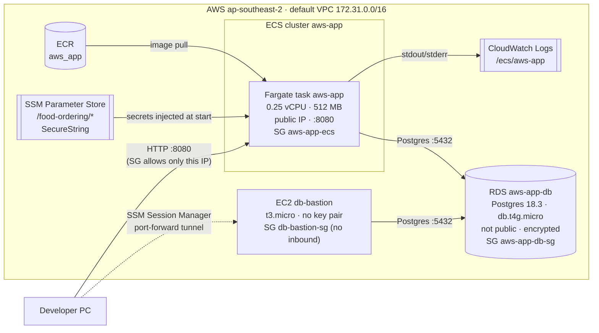

# AWS deployment

How the Food Ordering API runs on AWS (account `<ACCOUNT_ID>`, region
`ap-southeast-2`). Every value below was read from the live account on
2026-10-25. The commands that read them, plus the steps to rebuild the stack,
are in [`scripts/deploy.md`](scripts/deploy.md).

## Architecture



| Piece | Value |
|---|---|
| Image | `<ACCOUNT_ID>.dkr.ecr.ap-southeast-2.amazonaws.com/aws_app:20261025-132503` (also tagged `latest`, about 15 MB, scan on push enabled) |
| ECS | cluster `aws-app`, service `aws-app`, task definition `aws-app:2`, Fargate, 1 task, `X86_64` |
| Task size | 256 CPU units / 512 MiB, `awsvpc` networking, `assignPublicIp=ENABLED` |
| Subnets | the three default public subnets in 2a / 2b / 2c |
| Database | RDS `aws-app-db`, Postgres 18.3, `db.t4g.micro`, single-AZ, storage encrypted, `PubliclyAccessible=false`, database `aws_app` |
| Logs | `awslogs` driver → log group `/ecs/aws-app`, stream prefix `app`, 14-day retention |
| Migrations | Built into the binary (`sqlx::migrate!`) and run on every start, before the server binds. If they fail, the task exits. |

## Configuration and secrets

Plain environment variables in the task definition:

| Name | Value |
|---|---|
| `APP_HOST` | `0.0.0.0` |
| `APP_PORT` | `8080` |
| `RUST_LOG` | `info` |
| `JWT_TTL_MINUTES` | `60` |
| `DATABASE_MAX_CONNECTIONS` | `5` |

Secrets are kept in SSM Parameter Store as `SecureString`, encrypted with the
AWS-managed key `alias/aws/ssm`. They're referenced from the task definition's
`secrets` block. ECS reads and decrypts them with the execution role when the
task starts and injects them as environment variables. They never appear in
the image or in the task definition.

| Env var | Parameter |
|---|---|
| `DATABASE_URL` | `/food-ordering/DATABASE_URL` |
| `JWT_SECRET` | `/food-ordering/JWT_SECRET` |

ECS only reads the parameters at task start. After changing one, force a new
deployment (`aws ecs update-service --force-new-deployment`). Changing
`JWT_SECRET` invalidates every token that's been issued.

## IAM roles

| Role | Used by | Allowed to |
|---|---|---|
| `aws-app-ecs-execution` (task execution role) | The ECS agent, before the container starts. Trusts `ecs-tasks.amazonaws.com`. | Has `AmazonECSTaskExecutionRolePolicy`, which covers pulling from ECR and writing to CloudWatch Logs. It also has the inline policy `read-aws-app-ssm`, allowing `ssm:GetParameters` on `parameter/food-ordering/*` and `kms:Decrypt` only through `ssm.ap-southeast-2.amazonaws.com`. |
| Task role | The application code | **None is set.** The app doesn't call any AWS API, so it gets no credentials at all. That's the least-privilege choice. Add a task role only when the code needs AWS access (S3, SES, ECS Exec, ...), scoped to that need. |
| `ec2-ssm-role` (instance profile on `db-bastion`) | The SSM agent on the bastion | `AmazonSSMManagedInstanceCore` only, which is enough to register with Session Manager and accept sessions. |

## Security groups

| SG | Inbound | Outbound |
|---|---|---|
| `aws-app-ecs` (`<ECS_SG_ID>`), on the Fargate task | tcp 8080 from `<YOUR_PUBLIC_IP>/32` only (description `owner-ip`) | all |
| `aws-app-db-sg` (`<DB_SG_ID>`), on RDS | **Intended:** tcp 5432 from `aws-app-ecs` **and** tcp 5432 from `db-bastion-sg`. See the warning below. | all |
| `db-bastion-sg` (`<BASTION_SG_ID>`), on the bastion | **none** | all (the SSM agent makes outbound HTTPS to the SSM endpoints) |

RDS rules reference security groups, not IP ranges, so they keep working when
a task gets a new IP.

> **Warning: drift found on 2026-10-25.** At 14:19:42 JST, a console session
> edited the RDS rule `<DB_SG_RULE_ID>` (description `aws-app-ecs-tasks`)
> and changed its source from `aws-app-ecs` to `db-bastion-sg`, most likely
> while adding bastion access. Now only the bastion can reach the database.
> The running task still passes `/health` because that route doesn't touch the
> DB, but every DB-backed request times out, and a restarted task will fail its
> startup migrations. The fix is in `scripts/deploy.md`, under "Fix the RDS
> security group".

When your public IP changes, update the `aws-app-ecs` rule. Otherwise you'll
be locked out of the API.

## Admin database access (SSM tunnel through the bastion)

`db-bastion` (`<BASTION_INSTANCE_ID>`) has no SSH key pair and no inbound rules.
The only way in is AWS Systems Manager Session Manager. The SSM agent makes an
outbound connection to AWS, and your PC tunnels through it to RDS:

```powershell
aws ssm start-session --target <BASTION_INSTANCE_ID> `
  --document-name AWS-StartPortForwardingSessionToRemoteHost `
  --parameters '{"host":["aws-app-db.<RDS_ID>.ap-southeast-2.rds.amazonaws.com"],"portNumber":["5432"],"localPortNumber":["5433"]}'
```

Then, in another terminal, run `psql "postgres://<user>:<password>@localhost:5433/aws_app"`,
or point pgAdmin or DBeaver at `localhost:5433`. Access is controlled by IAM
(`ssm:StartSession`) and logged in CloudTrail. No port is open to the internet
and no keys need managing. You need the AWS CLI and the Session Manager plugin
installed locally.

## What I'd change for production

- **ALB with HTTPS.** Put an Application Load Balancer in front, with an ACM
  certificate on :443 and a redirect from :80, and send the API traffic
  through it. Give the task SG inbound access only from the ALB's SG. That
  gives you a stable DNS name (today the IP changes on every deploy), TLS
  (today passwords and tokens cross the internet in plain HTTP), and a
  target-group health check on `/health` so ECS replaces unhealthy tasks.
  Ideally also add a `/ready` route that checks the database.
- **Private subnets.** Run the tasks in private subnets with
  `assignPublicIp=DISABLED`. Give them outbound access through a NAT gateway,
  or, cheaper and tighter, through VPC endpoints for ECR (`ecr.api`,
  `ecr.dkr`), S3 (gateway endpoint, for image layers), CloudWatch Logs and SSM.
  Move the bastion into a private subnet as well, using the `ssm`,
  `ssmmessages` and `ec2messages` endpoints. RDS stays private.
- **Secrets Manager with rotation.** Move the DB credentials to Secrets Manager
  with automatic RDS rotation, or use RDS-managed master passwords. The app
  reads `DATABASE_URL` only at startup, so either build the URL from the
  rotated secret on each new connection or roll the service after each
  rotation. Use a dedicated least-privilege DB user for the app rather than
  the master user. Consider a customer-managed KMS key.
- **Graviton/arm64.** Build `linux/arm64` (`docker buildx build --platform
  linux/arm64`, see the Dockerfile) and set `runtimePlatform.cpuArchitecture=ARM64`.
  Fargate on arm64 costs about 20% less for the same size, and RDS is already
  on Graviton (`t4g`).
- **CI/CD.** On each push to `main`, run tests against a throwaway Postgres,
  build and scan the image, and push it with an immutable tag (the git SHA)
  to an ECR repo with `IMMUTABLE` tags. Then register a new task definition
  revision and update the service with the deployment circuit breaker and
  rollback enabled. Authenticate GitHub Actions to AWS with OIDC, not
  long-lived keys. Manage the infrastructure itself with Terraform, CDK or
  CloudFormation, so changes like the SG edit above are reviewed and
  reversible.
- **Smaller items.**
  - Multi-AZ RDS, automated backups with enough retention, and deletion
    protection.
  - Two or more tasks across AZs, plus service auto-scaling.
  - Longer log retention, and CloudWatch alarms on 5xx responses and task
    restarts.
  - Enable `enableExecuteCommand` only if it's needed. That requires a task
    role and an image with a shell.
